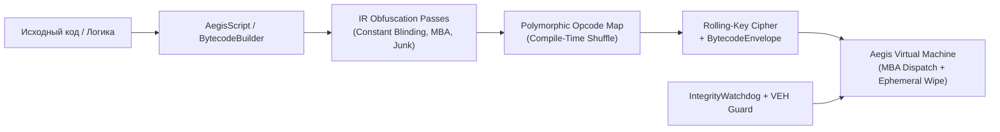

<div align="center">

# 🛡️ Aegis Protection Suite (`aegis_protection.hpp`)

**Single-Header C++20 Code Virtualization, Obfuscation, Cryptography & Anti-Tamper SDK**

[](https://en.cppreference.com/w/cpp/20)
[](#)
[](aegis_protection.hpp)
[](#)
[](#)

*Единый `header-only` инструмент промышленного класса (>10 000 строк C++20 кода в одном файле) без внешних зависимостей: стек-регистровая виртуальная машина с полиморфным байткодом, компилятор скриптов в V-ISA, 25+ криптографических примитивов, защита памяти, анти-отладка и система лицензирования.*

</div>

---

## 📦 Структура репозитория

Никаких внешних библиотек, сложных систем сборки или лишних файлов — только один заголовочный файл и набор модульных тестов:

```text
├── aegis_protection.hpp   # Единый заголовочный SDK (10,145 строк C++20, 67 подсистем)
├── test_all_in_one.cpp    # Полный тестовый стенд (20 тестовых наборов + 12 крипто-тестов KAT)
└── README.md              # Документация
```

---

## ⚡ Быстрый старт

Подключите один заголовок [`aegis_protection.hpp`](aegis_protection.hpp) в ваш проект:

```cpp
#include "aegis_protection.hpp"
```

### Сборка и запуск тестов (MSVC / Visual Studio)

```powershell
cl /std:c++20 /EHsc /W4 /O2 test_all_in_one.cpp /Fe:test_all_in_one.exe
.\test_all_in_one.exe
```

### Сборка (Clang / GCC)

```bash
clang++ -std=c++20 -O2 -Wall -Wextra test_all_in_one.cpp -o test_all_in_one
./test_all_in_one
```

---

## 🏛️ Архитектура и 67 интегрированных подсистем



| Категория | Пространство имён | Ключевые классы и возможности |
| :--- | :--- | :--- |
| **Виртуализация кода (VM)** | `aegis::vm` | `VirtualMachine`, `BytecodeBuilder`, `BytecodeChunk`, `VMContext`, `NativeBridge`, `PolymorphicOpcodeMap` (полиморфная таблица 256 опкодов при каждой компиляции), инструкции `OP_BSWAP`, `OP_POPCNT`, `OP_VMEMCPY`, `OP_VMEMSET`, `OP_REKEY`, `OP_JUNK` |
| **Компилятор и тулчейн ВМ** | `aegis::vm::*` | `AegisScriptCompiler` (компилятор C-подобного языка в байткод), `VmTextAssembler` (текстовый ассемблер), `BytecodeDisassembler` (дизассемблер + построитель CFG), `BytecodeDecompiler` (декомпилятор в C-псевдокод), `BytecodeObfuscationPipeline`, `SsaLifter` (SSA + Linear Scan), `BytecodeAbstractInterpreter`, `VMProfiler`, `VMDebugger` |
| **Обфускация времени компиляции** | `aegis::obf` | `Mba` (Mixed Boolean Arithmetic), `AEGIS_STR` / `AEGIS_STR_OBJ` (шифрование строк с автоочисткой стека), `AEGIS_INT` / `ObfuscatedInt`, `Opaque` (непрозрачные предикаты), `FlatteningMachine` (Control Flow Flattening), `EncryptedDispatchTable` |
| **Симметричные шифры и AEAD** | `aegis::crypto` | `Aes256` (ECB/CBC/CTR + PKCS#7), `ChaCha20`, `ChaCha20Poly1305` (RFC 8439 AEAD), `XChaCha20` (192-bit nonce), `Salsa20`, `Camellia256` (RFC 3713), `Serpent256` (32-раундовый SPN), `Threefish512` (72 раунда), `Blowfish`, `Rc6_256`, `Speck128`, `Simon128`, `Sm4`, `XTea` |
| **Криптографические хеши и KDF** | `aegis::crypto` | `Sha256` (FIPS 180-4 + HMAC), `Sha512` / `Sha384` (+ HMAC), `Keccak1600` (`sha3_256`, `sha3_512`, `shake256`), `Blake2b`, `Blake2s`, `Ascon320` (NIST SP 800-232), `Sm3`, `Poly1305`, `SipHash24`, `KdfEngine` (`pbkdf2_hmac_sha256`, `hkdf_extract`/`expand`, `memory_hard_derive`), `ChaCha20Drbg` (CSPRNG + UUIDv4) |
| **Асимметричная криптография и ECC** | `aegis::crypto` / `aegis::math` | `X25519` (RFC 7748 Curve25519 Diffie-Hellman), `Uint256` (`mod_add`, `mod_mul`, `mod_pow`), `ShamirSecretSharing` (схема Шамира $(K, N)$ в $GF(2^8)$), `SelfHealingBuffer` (самовосстанавливающийся буфер с кодами Хэмминга SEC-DED), `MerkleTree` (деревья Меркла и доказательства включения), `WhiteBoxByteNetwork` |
| **Анти-отладка и защита памяти** | `aegis::anti` / `aegis::veh` / `aegis::watchdog` / `aegis::syscall` | `AntiDebug` (PEB, `NtGlobalFlag`, `Dr0`–`Dr7`, `RDTSC`, `ThreadHideFromDebugger`, `ProcessDebugPort`), `AntiVm` (CPUID hypervisor vendor, MAC, реестр), `EmulatorDetector` (IEEE-754 NaN payload fidelity), `AntiDump` (`erase_pe_headers`), `IntegrityScanner`, `CodePatchGuard`, `ApiResolver` (`AEGIS_API` без IAT), `SyscallResolver` (проверка стабов `ntdll.dll` и извлечение SSN), `VehGuard` (очистка `Dr0`–`Dr7` через VEH), `IntegrityWatchdog` (фоновый поток мониторинга памяти) |
| **Лицензирование, VFS и утилиты** | `aegis::license` / `aegis::archive` / `aegis::watermark` | `LicenseManager` (генерация и проверка ключей `AEGIS-XXXX-...` с привязкой к HWID и ChaCha20-Poly1305), `AegisVfsArchive` (зашифрованная виртуальная ФС с LZSS-сжатием), `BytecodeWatermarker` (стеганографические водяные знаки в байткоде), `HardwareId` (TPM 2.0 EKPub + CPUID), `PeImageAnalyzer`, `UniversalBinaryInspector` (PE/ELF64/Mach-O), `SecurePacketChannel`, `EncryptedRingLogger`, `JsonParser` |

---

## 💻 Примеры использования

### 1. Виртуализация кода (Fluent Assembler & Polymorphic V-ISA)

```cpp
#include "aegis_protection.hpp"
#include <iostream>

int main() {
    using namespace aegis::vm;

    // Сборка полиморфного байткода с мусорными инструкциями и плавающим ключом
    BytecodeBuilder b(true);
    b.emit_junk(2)
     .mov(VReg::R1, 100)
     .mov(VReg::R2, 25)
     .add(VReg::R1, VReg::R2) // Вычисляется через MBA: (x ^ y) + ((x & y) << 1)
     .mov(VReg::R3, 5)
     .mul(VReg::R1, VReg::R3) // 625
     .mov(VReg::R0, VReg::R1)
     .halt();

    BytecodeChunk chunk = b.build(0x987654321ULL);

    VirtualMachine vm;
    std::cout << "VM Result: " << vm.run(chunk) << "\n"; // 625
}
```

### 2. Компиляция C-подобного скрипта (`AegisScript`) напрямую в байткод ВМ

```cpp
#include "aegis_protection.hpp"
#include <iostream>

int main() {
    std::string script = R"(
        let sum = 0;
        let i = 1;
        while (i <= 10) {
            sum = sum + (i * i);
            i = i + 1;
        }
        return sum;
    )";

    auto chunk = aegis::vm::compiler::AegisScriptCompiler::compile(script, 0xCAFEBABEULL, true);

    aegis::vm::VirtualMachine vm;
    std::cout << "Sum of squares (1..10): " << vm.run(chunk) << "\n"; // 385
}
```

### 3. Шифрование строк времени компиляции и скрытие констант

```cpp
#include "aegis_protection.hpp"
#include <iostream>

int main() {
    // Строка шифруется на этапе компиляции (constexpr) и автоматически затирается в стеке при выходе из области видимости
    {
        auto secret = AEGIS_STR_OBJ("Super_Secret_API_Token_2026");
        std::cout << "Decrypted: " << secret.c_str() << "\n";
    } // <-- Буфер гарантированно обнулён через secure_zero

    // Split-variable обфускация целых чисел через MBA
    AEGIS_INT_VAR(int, license_magic, 1337);
    std::cout << "Value: " << (license_magic + 63) << "\n"; // 1400
}
```

### 4. Фоновый сторожевой поток целостности (`IntegrityWatchdog`) и `VehGuard`

```cpp
#include "aegis_protection.hpp"

int main() {
    // Установка векторного обработчика исключений с автоочисткой аппаратных точек останова (DR0-DR7)
    aegis::veh::VehGuard::install(true);

    // Запуск фонового потока проверки целостности кода (Murmur3 + SHA-256 + проверка 0xCC / 0xE9 хуков)
    aegis::watchdog::IntegrityWatchdog watchdog;
    watchdog.add_region(reinterpret_cast<const void*>(&main), 64);
    watchdog.set_callback([](aegis::watchdog::ViolationType type, const void* addr) {
        // Реакция на попытку патчинга или установки брейкпоинта
    });
    watchdog.start(50);

    // ... защищённая логика приложения ...

    watchdog.stop();
    aegis::veh::VehGuard::uninstall();
}
```

### 5. Выпуск и проверка криптографических лицензий с привязкой к HWID

```cpp
#include "aegis_protection.hpp"
#include <iostream>

int main() {
    using namespace aegis::license;

    LicenseManager::MasterKey master_key{};
    for (size_t i = 0; i < 32; ++i) master_key[i] = static_cast<aegis::u8>(0xA0 + i);

    aegis::u64 hwid = aegis::hwid::HardwareId::get_machine_fingerprint();

    // Выпуск ключа формата AEGIS-XXXXX-XXXXX-... (зашифрован ChaCha20-Poly1305 AEAD)
    std::string key = LicenseManager::issue_license(
        master_key,
        /*license_id=*/1001,
        /*bound_hwid=*/hwid,
        /*issued_sec=*/1700000000ULL,
        /*expires_sec=*/2000000000ULL,
        FeatureFlags::TIER_ENTERPRISE | FeatureFlags::VM_PROTECTION,
        /*seats=*/1,
        "client_enterprise"
    );

    LicenseWirePayload info{};
    auto status = LicenseManager::verify_license(
        master_key, key, 1800000000ULL, hwid, FeatureFlags::TIER_ENTERPRISE, &info
    );

    if (status == LicenseStatus::Valid) {
        std::cout << "License valid for: " << info.licensee_id << "\n";
    }
}
```

---

## 📘 Подробная инструкция по использованию (Руководство разработчика)

### Шаг 1. Подключение в проект

Библиотека полностью состоит из одного файла [`aegis_protection.hpp`](aegis_protection.hpp) и не требует сборки `.lib` или `.dll`. На Windows все необходимые системные библиотеки (`ncrypt.lib`, `crypt32.lib`, `advapi32.lib`, `psapi.lib`, `iphlpapi.lib`) линкуются автоматически через `#pragma comment(lib, ...)`.

- **В Visual Studio (`.vcxproj`)**:
  1. Скопируйте [`aegis_protection.hpp`](aegis_protection.hpp) в папку вашего проекта.
  2. В свойствах проекта выберите **C/C++ → Language → C++ Language Standard** → `ISO C++20 Standard (/std:c++20)`.
  3. Добавьте `#include "aegis_protection.hpp"` в нужный `.cpp` файл.

- **В `CMakeLists.txt`**:
  ```cmake
  cmake_minimum_required(VERSION 3.20)
  project(ProtectedApp LANGUAGES CXX)

  set(CMAKE_CXX_STANDARD 20)
  set(CMAKE_CXX_STANDARD_REQUIRED ON)

  add_executable(ProtectedApp main.cpp aegis_protection.hpp)
  ```

---

### Шаг 2. Шпаргалка по макросам быстрой защиты

| Макрос | Назначение | Пример использования |
| :--- | :--- | :--- |
| `AEGIS_STR("...")` | Шифрует строку на этапе компиляции (`constexpr`), расшифровывает во временный буфер на стеке | `printf("%s\n", AEGIS_STR("Secret Text"));` |
| `AEGIS_STR_OBJ("...")` | Создаёт RAII-объект зашифрованной строки, который **автоматически затирает память** (`secure_zero`) при выходе из области видимости | `auto key = AEGIS_STR_OBJ("Bearer xyz");` |
| `AEGIS_INT(val)` | Скрывает числовую константу от статического анализа в IDA/Ghidra через разбиение и MBA | `int port = AEGIS_INT(8443);` |
| `AEGIS_INT_VAR(T, name, val)` | Создаёт обфусцированную переменную типа `ObfuscatedInt<T>` | `AEGIS_INT_VAR(uint32_t, flags, 0x1337);` |
| `AEGIS_API(mod, func, Type)` | Динамически находит экспортируемую функцию из PE-модуля в памяти по FNV-1a хешу **без записи в таблицу импорта (IAT)** | `auto pBeep = AEGIS_API("kernel32.dll", "Beep", BOOL(WINAPI*)(DWORD, DWORD));` |
| `AEGIS_DESYNC()` | Вставляет ложный условный переход с рассинхронизацией линейного дизассемблера (IDA/Ghidra) | `AEGIS_DESYNC();` |
| `"..."_fnv1a` | Вычисляет 64-битный хеш `FNV-1a` на этапе компиляции | `constexpr auto h = "ntdll.dll"_fnv1a;` |

---

### Шаг 3. Три способа виртуализации критического кода (V-ISA)

В [`aegis_protection.hpp`](aegis_protection.hpp) встроена гибридная стек-регистровая виртуальная машина (`16` 64-битных регистров `R0`–`R15`, стек на 1024 элемента, регистр флагов `FLAGS`, полиморфная таблица опкодов и шифрование байткода с плавающим ключом). Вы можете переводить функции в байткод тремя способами:

#### Способ А: C++ Builder + вызов нативных C++ функций (`NativeBridge`)
Позволяет собирать байткод прямо в C++ и вызывать изнутри виртуальной машины ваши обычные C++ функции:

```cpp
#include "aegis_protection.hpp"
#include <iostream>

int main() {
    using namespace aegis::vm;

    VirtualMachine vm;

    // Регистрируем нативную C++ функцию в мосту ВМ (возвращает u64, принимает VMContext&)
    aegis::u64 check_token_id = vm.native_bridge().register_function([](VMContext& ctx) -> aegis::u64 {
        aegis::u64 user_id = ctx.get_reg(VReg::R1);
        return (user_id == 42) ? 1ULL : 0ULL;
    });

    // Строим полиморфный байткод
    BytecodeBuilder b(/*polymorphic=*/true);
    b.mov(VReg::R1, 42)
     .call_native(check_token_id) // Результат (1) помещается в стек
     .pop(VReg::R0)               // Переносим результат в R0 (возвращаемое значение ВМ)
     .rekey(0x55AA55AAULL)        // Динамическая смена ключа шифрования прямо посреди исполнения
     .halt();

    BytecodeChunk chunk = b.build(/*initial_key=*/0x123456789ABCDEF0ULL);
    std::cout << "Auth result: " << vm.run(chunk) << "\n"; // 1
}
```

#### Способ Б: Текстовый ассемблер ВМ (`VmTextAssembler`)
Позволяет писать программы на ассемблере ВМ с метками (`.loop:`), ветвлениями и вычислениями:

```cpp
auto chunk = aegis::vm::assembler::VmTextAssembler::assemble(R"(
    mov r1, 10
    mov r2, 20
    bswap r1
    popcnt r1
    add r1, r2
    mov r0, r1
    halt
)", 0xABCDEF123456ULL, /*polymorphic=*/true);

aegis::vm::VirtualMachine vm;
aegis::u64 result = vm.run(chunk);
```

#### Способ В: Мини-компилятор C-подобного языка (`AegisScriptCompiler`) + 3-слойный криптоконверт (`BytecodeEnvelope`)
Вы можете скомпилировать скрипт с переменными `let`, условиями `if / else` и циклами `while`, а затем упаковать полученный `BytecodeChunk` в **3-слойный защищённый конверт** (LZSS-сжатие → White-Box S-Box сеть → ChaCha20-Poly1305 AEAD) для хранения на диске или передачи по сети:

```cpp
// 1. Компилируем алгоритм в байткод
auto chunk = aegis::vm::compiler::AegisScriptCompiler::compile(R"(
    let a = 15;
    let b = 27;
    if (a < b) {
        return (a * b) + 100;
    } else {
        return 0;
    }
)", 0x77777777ULL, true);

// 2. Запечатываем байткод в криптоконверт для хранения/передачи
aegis::u8 master_key[32] = {1, 2, 3, 4};
std::vector<aegis::u8> sealed_blob = aegis::whitebox::BytecodeEnvelope::seal_chunk(chunk, master_key, 0x99887766ULL);

// 3. В рантайме распаковываем и исполняем
aegis::vm::BytecodeChunk restored{};
if (aegis::whitebox::BytecodeEnvelope::unseal_chunk(sealed_blob, master_key, 0x99887766ULL, restored)) {
    aegis::vm::VirtualMachine vm;
    auto res = vm.run(restored); // 505
}
```

---

### Шаг 4. Готовый шаблон комплексной защиты точки входа (`main`)

Скопируйте этот шаблон для включения всех эшелонов защиты при старте вашего приложения:

```cpp
#include "aegis_protection.hpp"
#include <iostream>

void critical_business_logic() {
    AEGIS_DESYNC();
    auto msg = AEGIS_STR_OBJ("Protected logic executed safely!");
    std::cout << msg.c_str() << "\n";
}

int main() {
    // 1. Стираем PE-заголовки в оперативной памяти (против дамперов Scylla / Process Hacker)
    aegis::anti::AntiDump::erase_pe_headers();

    // 2. Скрываем текущий поток от отладчика и ставим VEH-защиту от аппаратных брейкпоинтов (DR0-DR7)
    aegis::anti::AntiDebug::hide_current_thread();
    aegis::veh::VehGuard::install(/*auto_scrub_dr=*/true);

    // 3. Проверяем окружение (отладчик, гипервизор/VM, бинарные эмуляторы Unicorn/QEMU, хуки в ntdll.dll)
    if (aegis::anti::AntiDebug::is_debugger_active() ||
        aegis::anti::EmulatorDetector::is_emulated_environment()) {
        return -1;
    }

    auto syscall_info = aegis::syscall::SyscallResolver::inspect("NtQueryInformationProcess");
    if (syscall_info.is_hooked) {
        // В прологе системного вызова ntdll.dll обнаружен inline-хук (JMP/INT3)
        return -2;
    }

    // 4. Берём под охрану машинный код критических функций (CodePatchGuard + фоновый IntegrityWatchdog)
    aegis::anti::CodePatchGuard patch_guard;
    patch_guard.protect_function(reinterpret_cast<const void*>(&critical_business_logic), 64, "critical_logic");

    aegis::watchdog::IntegrityWatchdog watchdog;
    watchdog.add_region(reinterpret_cast<const void*>(&critical_business_logic), 64);
    watchdog.start(/*interval_ms=*/50);

    // 5. Выполняем защищённый код
    critical_business_logic();

    // 6. Проверяем отсутствие патчей и корректно останавливаем сторожевой поток
    if (!patch_guard.verify_all()) {
        return -3;
    }

    watchdog.stop();
    aegis::veh::VehGuard::uninstall();
    return 0;
}
```

---

### Шаг 5. Зашифрованный виртуальный архив (`AegisVfsArchive`) и самовосстанавливающаяся память (`SelfHealingBuffer`)

- **Хранение конфигов, ключей и ассетов в памяти (`AegisVfsArchive`)**:
  Все файлы автоматически сжимаются алгоритмом `LZSS`, шифруются через `ChaCha20-Poly1305 AEAD` с индивидуальным `nonce` и индексируются по `FNV-1a` хешу пути:
  ```cpp
  aegis::archive::AegisVfsArchive::MasterKey vfs_key{};
  aegis::archive::AegisVfsArchive vfs(vfs_key);

  // Добавление файла в архив
  std::string json_cfg = R"({"server": "https://api.example.com", "timeout": 30})";
  vfs.add_file("config/settings.json",
               reinterpret_cast<const aegis::u8*>(json_cfg.data()),
               json_cfg.size(),
               /*compress=*/true);

  // Сериализация всего архива в один бинарный блоб
  std::vector<aegis::u8> archive_blob = vfs.serialize();

  // Монтирование и чтение файла в рантайме
  aegis::archive::AegisVfsArchive mounted_vfs(vfs_key);
  mounted_vfs.mount(archive_blob);
  std::vector<aegis::u8> decrypted_cfg = mounted_vfs.read_file("config/settings.json");
  ```

- **Защита секретов в RAM от патчинга и сбоев (`SelfHealingBuffer` + `ShamirSecretSharing`)**:
  - `aegis::crypto::SelfHealingBuffer` кодирует каждый байт кодами Хэмминга **SEC-DED (12, 8)** и поддерживает XOR-страйпинг, автоматически восстанавливая повреждённые или пропатченные в памяти байты при вызове `scrub_and_heal()`.
  - `aegis::crypto::ShamirSecretSharing::split(secret, N, K, seed)` разделяет мастер-ключ на `N` долей в поле Галуа $GF(2^8)$ так, что для сборки ключа обратно через `combine()` требуется минимум `K` долей.

---

## 🧪 Результаты самотестирования (`test_all_in_one.cpp`)

При запуске [`test_all_in_one.cpp`](test_all_in_one.cpp) автоматически проверяются все 20 ключевых контуров защиты и встроенный криптографический пакет KAT (`SelfTestSuite`):

```text
=====================================================
      AEGIS ALL-IN-ONE SINGLE-HEADER TEST RUNNER     
=====================================================
[1] Testing Virtual Machine (V-ISA)...                  -> [PASSED]
[2] Testing Compile-Time String Encryption...           -> [PASSED]
[3] Testing Split Integer (AEGIS_INT)...                -> [PASSED]
[4] Testing Mixed Boolean Arithmetic (MBA)...           -> [PASSED]
[5] Testing Anti-Debugging Checks...                    -> [PASSED]
[6] Testing Memory Integrity Scanner...                 -> [PASSED]
[7] Testing Dynamic API Resolver...                     -> [PASSED]
[8] Testing Hardware ID & TPM...                        -> [PASSED]
[9] Testing Memory Scanner...                           -> [PASSED]
[10] Testing SHA-256 & HMAC-SHA256...                   -> [PASSED]
[11] Testing ChaCha20 Stream Cipher...                  -> [PASSED]
[12] Testing Polymorphic VM & Extended V-ISA...         -> [PASSED]
[13] Testing NTDLL Syscall Stub Inspector...            -> [PASSED]
[14] Testing VEH Hardware Breakpoint Guard...           -> [PASSED]
[15] Testing Background Memory Integrity Watchdog...    -> [PASSED]
[16] Testing Built-in Cryptographic KAT Suite (12/12)...-> [PASSED]
[17] Testing V-ISA Text Assembler, CFG & Decompiler...  -> [PASSED]
[18] Testing Cryptographic License Engine...            -> [PASSED]
[19] Testing Encrypted VFS, Merkle, Serpent & ECC...    -> [PASSED]
[20] Testing Steganographic Watermarking & Reporter...  -> [PASSED]

[SUCCESS] ALL 20 SINGLE-HEADER SUBSYSTEMS (10,100+ LOC) OPERATING FLAWLESSLY!
```
